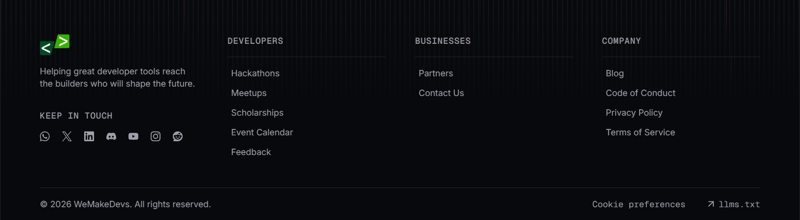

# Section from wemakedevs.org

From [wemakedevs.org](https://www.wemakedevs.org/wispr) · #section

## Why I like it

> I liked this footer. Can you check and keep it in note for our portfolio website? We can use this type of footer

## Design values

Read from the live page's computed styles, so they are the real values, not guesses.

| | |
| --- | --- |
| Colors | `lab(65.6464 1.53497 -5.42429)` text, `lab(64.4948 55.7544 46.8151)` background, `lab(100 0 0 / 0.1)` border |
| Sits on | `lab(2.56785 -0.0539348 -1.53846)` |
| Gradients | `linear-gradient(rgba(0, 0, 0, 0) 0%, lab(64.4948 55.7544 46.8151) 50%, rgba(0, 0, 0, 0) 100%)`, `linear-gradient(to right, rgba(0, 0, 0, 0) calc(50% - 0.5px), oklab(0.999998 -0.00000980496 0.0000234246 / 0.05) calc(50% - 0.5px), oklab(0.999998 -0.00000980496 0.0000234246 / 0.05) calc(50% + 0.5px), rgba(0, 0, 0, 0) calc(50% + 0.5px))`, `linear-gradient(color(srgb 0 0 0 / 0), rgba(0, 0, 0, 0) 85%)` |
| Layout | `block` |
| Fonts | Inter, Geist Mono |
| Type | `14px / 400 / 20px`, `14px / 500 / 20px / 0.7px` |
| Radius | — |
| Shadows | — |
| Spacing | `gap 6px`, `padding 16px 0px 0px 0px`, `gap 12px`, `padding 56px 64px 0px 64px`, `gap 48px`, `padding 16px 0px`, `gap 16px`, `gap 32px` |
| Borders | `0.8px solid lab(100 0 0 / 0.1)` |
| Motion | `transition: transform 0.3s cubic-bezier(0.4, 0, 0.2, 1), translate 0.3s cubic-bezier(0.4, 0, 0.2, 1), scale 0.3s cubic-bezier(0.4, 0, 0.2, 1), rotate 0.3s cubic-bezier(0.4, 0, 0.2, 1)`, `transition: color 0.2s cubic-bezier(0.4, 0, 0.2, 1), background-color 0.2s cubic-bezier(0.4, 0, 0.2, 1), border-color 0.2s cubic-bezier(0.4, 0, 0.2, 1), outline-color 0.2s cubic-bezier(0.4, 0, 0.2, 1), text-decoration-color 0.2s cubic-bezier(0.4, 0, 0.2, 1), fill 0.2s cubic-bezier(0.4, 0, 0.2, 1), stroke 0.2s cubic-bezier(0.4, 0, 0.2, 1), --tw-gradient-from 0.2s cubic-bezier(0.4, 0, 0.2, 1), --tw-gradient-via 0.2s cubic-bezier(0.4, 0, 0.2, 1), --tw-gradient-to 0.2s cubic-bezier(0.4, 0, 0.2, 1)`, `transition: 0.3s cubic-bezier(0.4, 0, 0.2, 1)`, `transition: color 0.15s cubic-bezier(0.4, 0, 0.2, 1), background-color 0.15s cubic-bezier(0.4, 0, 0.2, 1), border-color 0.15s cubic-bezier(0.4, 0, 0.2, 1), outline-color 0.15s cubic-bezier(0.4, 0, 0.2, 1), text-decoration-color 0.15s cubic-bezier(0.4, 0, 0.2, 1), fill 0.15s cubic-bezier(0.4, 0, 0.2, 1), stroke 0.15s cubic-bezier(0.4, 0, 0.2, 1), --tw-gradient-from 0.15s cubic-bezier(0.4, 0, 0.2, 1), --tw-gradient-via 0.15s cubic-bezier(0.4, 0, 0.2, 1), --tw-gradient-to 0.15s cubic-bezier(0.4, 0, 0.2, 1)` |

## Files

- `shot.png`: the element as it looked (1300×358 px)
- `snippet.html`: its markup with computed styles inlined, scripts removed. A reference for structure and values, not code to ship.

## How to use this (for coding agents)

1. Read **Why I like it** first: that is what to keep.
2. Rebuild it with the target project's own components, tokens and stack. Map the values above to the project's closest tokens instead of hard-coding them, unless asked to match exactly.
3. Use `snippet.html` for structure and exact values, not as code to paste.
