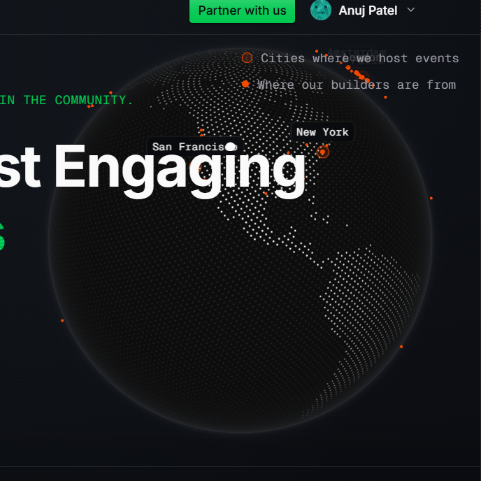

# Section from wemakedevs.org

From [wemakedevs.org](https://www.wemakedevs.org/) · #section

## Why I like it

> The 3D visualized Earth shows how it rotates slowly and it represents different states. It can be used on any page where we have to show a worldwide globe with different locations

## Design values

Read from the live page's computed styles, so they are the real values, not guesses.

| | |
| --- | --- |
| Colors | — |
| Sits on | `lab(2.56785 -0.0539348 -1.53846)` |
| Gradients | — |
| Layout | `block` |
| Fonts | — |
| Type | — |
| Radius | — |
| Shadows | — |
| Spacing | — |
| Borders | — |
| Motion | `transition: opacity 0.7s cubic-bezier(0.4, 0, 0.2, 1)` |

## Files

- `shot.png`: the element as it looked (550×550 px)
- `snippet.html`: its markup with computed styles inlined, scripts removed. A reference for structure and values, not code to ship.

## How to use this (for coding agents)

1. Read **Why I like it** first: that is what to keep.
2. Rebuild it with the target project's own components, tokens and stack. Map the values above to the project's closest tokens instead of hard-coding them, unless asked to match exactly.
3. Use `snippet.html` for structure and exact values, not as code to paste.
