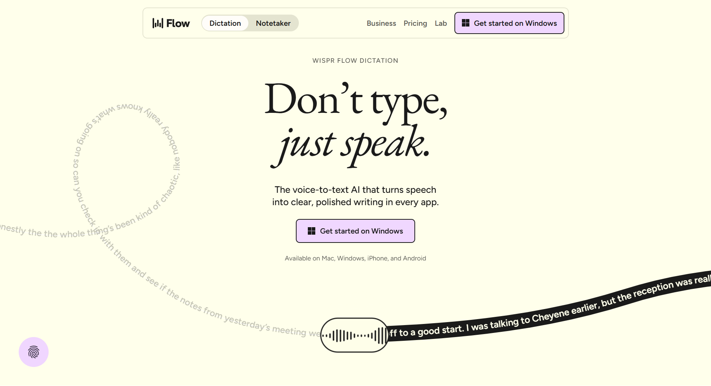

# Section from wisprflow.ai

From [wisprflow.ai](https://wisprflow.ai/) · #section

## Why I like it

> I like their hero section because they represent the feel of the product: how they convey that product feel on their landing page

## Design values

Read from the live page's computed styles, so they are the real values, not guesses.

| | |
| --- | --- |
| Colors | `#1a1a1a` background, `#e4e4d0` background, `#034f46` background, `#ffffeb` background, `#f0d7ff` background, `#ffa946` background, `#ff6c4c` background, `#34d399` background, `#1a1a1ab3` text, `#000000` icon |
| Sits on | `#ffffeb` |
| Gradients | `linear-gradient(rgba(255, 255, 255, 0), rgba(0, 0, 0, 0.7))` |
| Layout | `block` |
| Fonts | Figtree, Eb garamond |
| Type | `32px / 400 / 30.4px / -0.96px`, `20px / 500 / 26px`, `18px / 600 / 23.4px`, `16px / 400 / 20.8px`, `16px / 600 / 20.8px`, `14px / 500 / 18.2px / 1.12px` |
| Radius | `32px`, `48px`, `80px 80px 0px 0px`, `16px`, `80px`, `100%` |
| Shadows | — |
| Spacing | `gap 64px`, `gap 32px`, `padding 16px`, `padding 0px 40px`, `padding 128px 0px 0px 0px`, `padding 24px 0px 0px 0px`, `padding 16px 0px 0px 0px`, `padding 48px 0px 0px 0px` |
| Borders | — |
| Motion | `animation: logoTicker1 40s linear`, `transition: color 0.3s`, `transition: stroke-dashoffset 0.9s cubic-bezier(0.4, 0, 0.2, 1)`, `transition: opacity 0.1s` |

## Files

- `shot.png`: the element as it looked (1521×16161 px)
- `snippet.html`: its markup with computed styles inlined, scripts removed. A reference for structure and values, not code to ship.

## How to use this (for coding agents)

1. Read **Why I like it** first: that is what to keep.
2. Rebuild it with the target project's own components, tokens and stack. Map the values above to the project's closest tokens instead of hard-coding them, unless asked to match exactly.
3. Use `snippet.html` for structure and exact values, not as code to paste.
